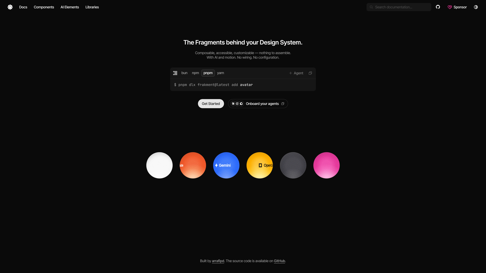

<div align="center">

<picture>
  <source media="(prefers-color-scheme: dark)" srcset="assets/logo-dark.svg">
  
</picture>

# Frakment

**The Fragments behind your Design System.**

Composable, accessible, customizable — inherently reusable.

[](LICENSE)
[](https://www.npmjs.com/package/frakment)
[](https://github.com/arrafipd/frakment/actions/workflows/ci.yml)



</div>

---

**Frakment** is a component registry for React — copy-paste primitives you own, with AI and motion built in.

> **Pre-1.0 (`0.0.x`)** — APIs may change between releases. Pin a version and read the changelog before upgrading.

## Quick start

```bash
npx frakment@latest init      # once per project
npx frakment@latest add button
```

`init` sets up `components.json`, injects the theme into `globals.css`, and installs base dependencies. `add` fetches a component plus every registry dependency it needs.

## Highlights

- **46 components** across base, AI elements, and modules
- **You own the source** — every component lands as source in your repo, fully editable
- **Accessible by default** — ARIA-first, a11y tested
- **AI and motion built in** — chat/agent primitives and Motion-ready baseline
- **Built for agents** — MCP server and Agent Skills for autonomous discovery

Browse the full catalog: **[arrafi.dev/frakment/docs/components](https://www.arrafi.dev/frakment/docs/components)**

## Requirements

- **Node.js** `>=22` (see `.nvmrc`)
- **React** `19`
- **Tailwind CSS** `v4`

## Updating

`npx frakment add <name>` overwrites the existing file. To update safely:

1. **Commit** your current version so you can review diffs.
2. Run `npx frakment add <name>` to fetch the latest.
3. Run `git diff` to merge local customizations.

Read the [changelog](https://github.com/arrafipd/frakment/releases) before updating — APIs may change between `0.0.x` releases.

## Built for agents

Frakment ships with an MCP server and Agent Skills so AI tools can discover and install components autonomously.

```bash
npx -y @frakment/mcp
```

- **MCP server** → [arrafi.dev/frakment/docs/utilities/mcp](https://www.arrafi.dev/frakment/docs/utilities/mcp)
- **Agent Skills** → [arrafi.dev/frakment/docs/utilities/skills](https://www.arrafi.dev/frakment/docs/utilities/skills)
- **llms.txt** → [arrafi.dev/frakment/llms.txt](https://www.arrafi.dev/frakment/llms.txt)

## Documentation

| | |
| :--- | :--- |
| [**Components**](https://www.arrafi.dev/frakment/docs/components) | All shipped primitives |
| [**AI Elements**](https://www.arrafi.dev/frakment/docs/ai-elements) | Chat and agent primitives |
| [**Installation**](https://www.arrafi.dev/frakment/docs/installation) | Next.js, Vite, Astro, manual |
| [**Theming**](https://www.arrafi.dev/frakment/docs/theming) | CSS variables, dark mode, tokens |
| [**Changelog**](https://www.arrafi.dev/frakment/docs/changelog) | What shipped, when |

## Contributing

Contributions welcome — typo fixes, docs, tests, translations, or new components. See [CONTRIBUTING.md](./CONTRIBUTING.md).

## License

MIT — see [LICENSE](./LICENSE) and [THIRD_PARTY_NOTICES.md](./THIRD_PARTY_NOTICES.md).